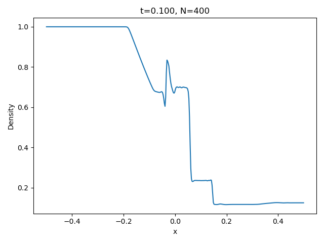
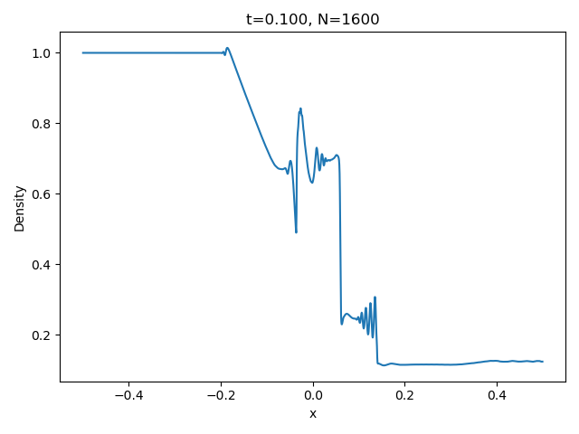
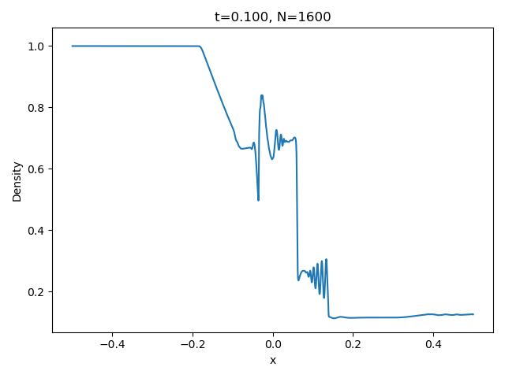

## Shock Tube Problem
This problem demonstrates the Hall-MHD version of the standard MHD shock tube problems adopted in `1D/SERIAL/shock`.<br>
Due to the dispersive nature of Hall-MHD, discontinuous jumps and smooth rarefaction waves of MHD solutions may be distorted.

The three panels show the Hall-MHD Brio & Wu density profile at `t=0.100` with ion inertia length *d<sub>i</sub>=0.001* (set `NUM=2` in `mhd1d_init_.cpp`). At 400 cells (left), the grid spacing is larger than the ion inertia length and the profile is close to the MHD solution. At 1600 cells (middle), the finer grid resolves a dispersive wave train. The right panel uses the same fine grid with an artificial electron inertia length of one grid spacing (*d<sub>e</sub>=&Delta;x=0.000625*).

| 400 cells · `D_ELE=0` | 1600 cells · `D_ELE=0` | 1600 cells · `D_ELE=1` |
|:---:|:---:|:---:|
|  |  |  |

All three runs use `RMN=2` (LHLLD), `ODR=4`, `R_K=3`, `CFL=0.4`, `DTREC=0.01`, and `D_ION=1e-3`, with GCC 16.2.0 (C++17, `-O2`) and `OMP_NUM_THREADS=2`.

To reproduce a panel, set `XMESH` and `D_ELE` in `mymacros.hpp` to the values above it, then rebuild and run as described in the [SERIAL guide](../README.md). `N_OUT=10` is sufficient to reach the plotted time. Execute `batch.py` in an interactive Python session, enter `dat`, and select output index `10`. To plot density alone:

```pycon
>>> plt.figure(figsize=(6.4, 4.8))
>>> plt.plot(x, ro)
>>> plt.xlabel("x")
>>> plt.ylabel("Density")
>>> plt.title(f"t={t[sst]:.3f}, N={x.size}")
>>> plt.tight_layout()
>>> plt.show(block=False)
```

### Neumann boundaries

Density and transverse magnetic fields are reflected evenly at both boundaries. The [Hall solver](../common/hmhd1d_solve.cpp) reflects the transverse Hall velocities `hy` and `hz` with opposite sign because they depend on the spatial derivatives of `Bz` and `By`, respectively.

**Known limitation with artificial electron inertia (`D_ELE > 0`).** The filter solves for the electric field on cell faces using cell-center boundary indexing. It includes the left boundary face in the solve but overwrites the right boundary face as a ghost value. In a filter test with `D_ELE=1` and `ODR=4`, a unit input on the left boundary face gave a peak response of 0.6021. The same input on the right gave zero everywhere.

## License

This project is licensed under the GNU General Public License v3.0 - see the [license](../../../license/COPYING) file for details.

[^1]: [Amano, T. 2015, JCP](https://www.sciencedirect.com/science/article/abs/pii/S0021999115004805?via%3Dihub)
