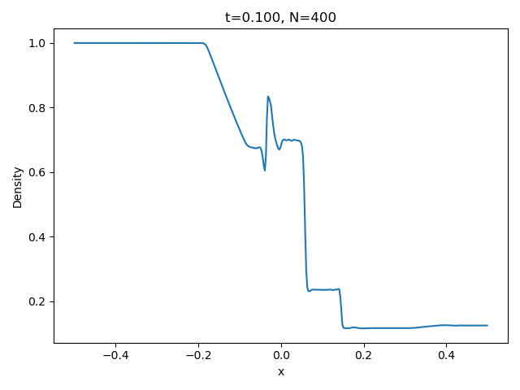
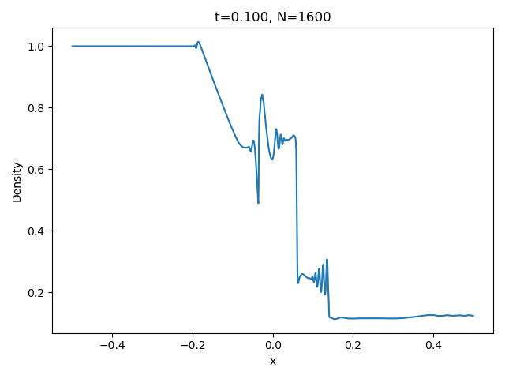

## Shock Tube Problem
This problem demonstrates the Hall-MHD version of the standard MHD shock tube problems adopted in `1D/SERIAL/shock`.<br>
Due to the dispersive nature of Hall-MHD, discontinuous jumps and smooth rarefaction waves of MHD solutions may be distorted.

The following shows the density profile at `t=0.100` of the Hall-MHD version of the Brio & Wu problem[^1] (set `NUM=2` in `mhd1d_init_.cpp`).<br>
The ion inertia length *d<sub>i</sub>=0.001* is used.<br>
The solution in the left plot is close to the MHD solution because the grid width *&Delta;x=0.0025* is larger than the ion inertia length.<br>
In contrast, the dispersive wave train appears behind discontinuities in the right plot when the grid width *&Delta;x=0.000625* is smaller than the ion inertia length.<br>

These figures were regenerated with `XMESH=400` and `1600`, `RMN=2` (LHLLD), `ODR=4`, `R_K=3`, `CFL=0.4`, `DTREC=0.01`, `D_ION=1e-3`, and `D_ELE=0`, using GCC 16.2.0 (C++17, `-O2`) and `OMP_NUM_THREADS=2`. No artificial electron inertia is used.

To reproduce them, set `XMESH` in `mymacros.hpp` to each resolution, then rebuild and run as described in the [SERIAL guide](../README.md). `N_OUT=10` is sufficient to reach the plotted time. Execute `batch.py` in an interactive Python session, enter `dat`, and select output index `10`. To plot density alone:

```pycon
>>> plt.figure(figsize=(6.4, 4.8))
>>> plt.plot(x, ro)
>>> plt.xlabel("x")
>>> plt.ylabel("Density")
>>> plt.title(f"t={t[sst]:.3f}, N={x.size}")
>>> plt.tight_layout()
>>> plt.show(block=False)
```



## License

This project is licensed under the GNU General Public License v3.0 - see the [license](../../../license/COPYING) file for details.

[^1]: [Amano, T. 2015, JCP](https://www.sciencedirect.com/science/article/abs/pii/S0021999115004805?via%3Dihub)
