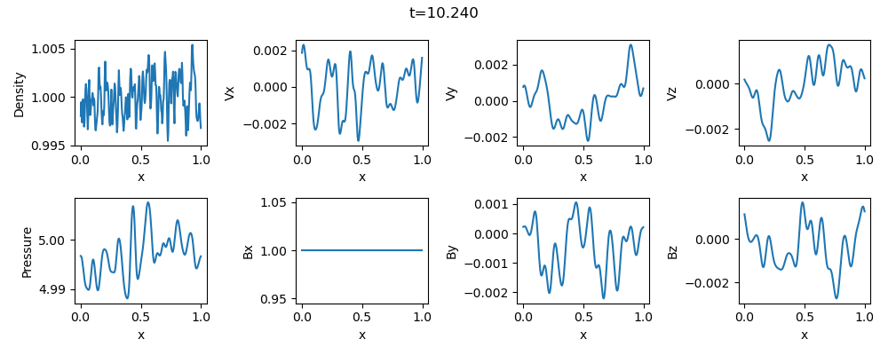
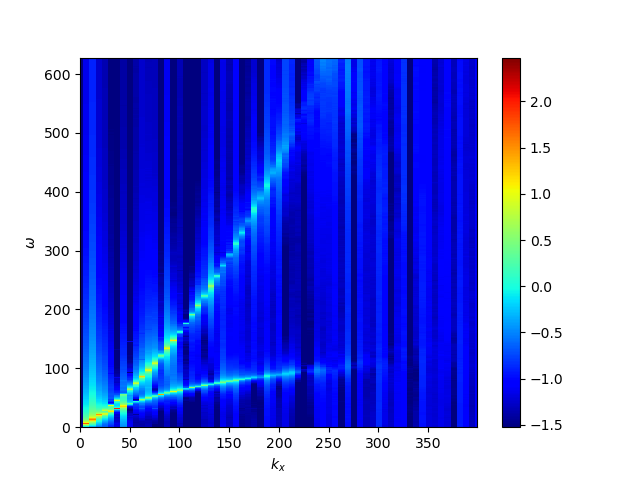
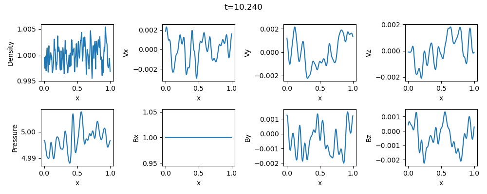
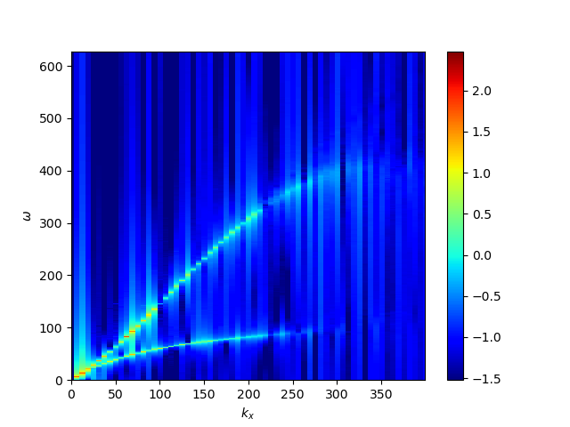

## Wave Propagation Problem
This problem demonstrates the propagation of Hall-MHD waves in homogeneous plasma to confirm that the code successfully satisfies the linear dispersion.<br>
Random white noise is added to the magnetic field and pressure, and their perturbations propagate as the whistler and ion cyclotron,  and magnetosonic waves.

These figures were regenerated with `XMESH=256`, `RMN=2` (LHLLD), `ODR=4`, `R_K=3`, `CFL=0.4`, `DTREC=0.005`, `N_OUT=4095`, and `D_ION=1e-2`, using GCC 16.2.0 (C++17, `-O2`) and `OMP_NUM_THREADS=2`. Initialization uses `rand_noise_mt()` with `std::mt19937` and seed `10`; the random realization differs from the legacy generator used for the old figures.

To reproduce them, keep `beta=10.0` in `mhd1d_init_.cpp`, set `D_ELE` in `mymacros.hpp` to `0.0` or `1.0`, then rebuild and run as described in the [SERIAL guide](../README.md). In an interactive Python session, execute:

```pycon
>>> exec(open("batch_a.py").read())
>>> exec(open("wk_plt.py").read())
```

For `batch_a.py`, enter `dat` and select output index `2048` for the spatial profiles at `t=10.240`. Keep `val=by` in `wk_plt.py`; the magnetic-field spectrum uses all 4096 snapshots from `t=0` to `20.475`. The color scale is `log10(abs(FFT))`.

The result for *&beta;=10*, the grid width *&Delta;x=0.00390625*, and the ion inertia length *d<sub>i</sub>=0.01*, without artificial electron inertia (`D_ELE=0`), is shown below.<br>
Dispersion relation of the whistler and ion cyclotron waves is observed in the spectrum plot of the magnetic field.



It is well known that the dispersive nature of the whistler waves (phase velocity proportional to wavenumber) is unfavorable condition for Hall-MHD simulations in terms of numerical stability.<br>
To relax this issue, the code can introduce the upper bound to the phase velocity of whistler waves through an "artificial" electron inertia, motivated by the study of Amano[^1].<br>

The result for the artificial electron inertia length *d<sub>e</sub>=&Delta;x* (`D_ELE=1`) is shown below.<br>
The dispersion relation of the whistler wave *&omega; = V<sub>a</sub>d<sub>i</sub>k<sub>x</sub><sup>2</sup>* is modified to *&omega; = V<sub>a</sub>d<sub>i</sub>k<sub>x</sub><sup>2</sup>/(1+d<sub>e</sub><sup>2</sup>k<sub>x</sub><sup>2</sup>)*, limiting the maximum phase velocity to *V<sub>a</sub>d<sub>i</sub>/2d<sub>e</sub>*.



## License

This project is licensed under the GNU General Public License v3.0 - see the [license](../../../license/COPYING) file for details.

[^1]: [Amano, T. 2015, JCP](https://www.sciencedirect.com/science/article/abs/pii/S0021999115004805?via%3Dihub)
