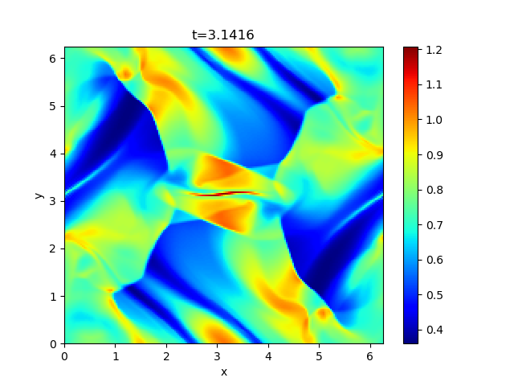

## Orszag-Tang Vortex Problem

The Orszag-Tang vortex problem is a standard benchmark test for the two-dimensional MHD simulation adopted in many literatures, to verify the capability of capturing multiple interactions of shocks and vortices.<br>
The initial condition is *(&rho;,v<sub>x</sub>,v<sub>y</sub>,v<sub>z</sub>,B<sub>x</sub>,B<sub>y</sub>,B<sub>z</sub>,P)*=*(&gamma;<sup>2</sup>,-sin(y),sin(x),0,-sin(y),sin(2x),0,&gamma;)* where *&gamma;*=5/3 is specific heat ratio, and *0<x,y<2&pi;*.

An example of the temperature *(=P/&rho;)* profile at `t=3.1416` (approximately *&pi;*) is shown below.



This figure is shared with the SERIAL example and was generated there with `XMESH=YMESH=200`, `RMN=2` (LHLLD), `ODR=2`, `R_K=3`, `CTW=1`, `CFL=0.4`, `DTREC=0.2*3.1416`, and `N_OUT=5`, using GCC 16.2.0 (C++17, `-O2`) and `OMP_NUM_THREADS=2`. To reproduce this time with MPI, set `N_OUT=5` (the current default is `6`), run and merge the data as described below, then select output index `5` in `batch.py`; its default plot shows `pr/ro`. The title uses the actual time in `t.dat`.

### MPI configuration

This case uses the shared MPI `MHD2D` class and solver in `../common/`. Shared sources are compiled separately for this case with its local `mymacros.hpp`. Edit `mhd2d_init_.cpp` for the initial state, `mhd2d_paras.cpp` for the domain and boundary conditions, and `mymacros.hpp` for the global mesh, MPI decomposition (`MNP_X`, `MNP_Y`), output, and solver settings.

The `setup_grid()` call takes global domain bounds and explicitly supplies coordinate shifts `0.0, 0.0`, unlike the default half-cell shifts used by the other cases. Preserve these arguments when changing the domain to retain this case's original coordinate convention.

### How to run and visualize

After building the repository-level libraries as described in the [root README](../../../README.md#installation), run these commands from this problem directory:

```sh
make
mkdir -p dat
mpiexec -np 4 env OMP_NUM_THREADS=2 ./a.out
make -C ../common
./merge.out dat
python -i batch.py
```

The default `MNP_X=MNP_Y=2` requires four MPI processes; adjust `-np` to `MNP_X*MNP_Y` if you change the decomposition. `OMP_NUM_THREADS` sets the number of threads per process. Objects are stored in `build/` and the executable is `a.out`.

Build the shared merge utility once with `make -C ../common`. After the simulation finishes, `./merge.out dat` reads rank-local output and writes merged files in the same directory. Enter `dat` and the desired output index at the `batch.py` prompts. The `-i` option keeps the loaded arrays available for additional plotting commands.

The merged `bx, by, bz` arrays are cell-centered; `bxct, byct` retain the CT face fields. Keep the `merge_bx_face_XXXXX.dat` and `merge_by_face_XXXXX.dat` companions alongside each `merge_outdat_XXXXX.dat` file. See [the MPI guide](../README.md) for output formats and restart behavior; an existing backup in `dat/` is loaded automatically when available.

## License

This project is licensed under the GNU General Public License v3.0 - see the [license](../../../license/COPYING) file for details.
