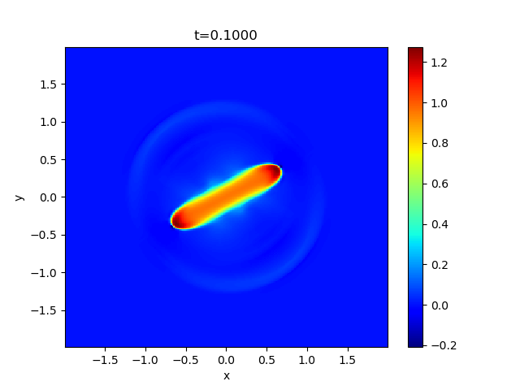
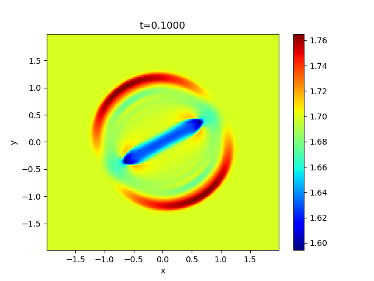

## Blast Wave Problem

This problem suggested by Balsara & Spicer[^1] demonstrates the propagation of MHD shocks in strongly magnetized meidum to assess the robustness of the code.<br>
The initial condition is *(&rho;,v<sub>x</sub>,v<sub>y</sub>,v<sub>z</sub>,B<sub>x</sub>,B<sub>y</sub>,B<sub>z</sub>,P)*=*(1,0,0,0,10cos(&theta;),10sin(&theta;),0,1)*, and then a high pressure cylinder is imposed at the center of the domain, *P=100* for *&radic;(x<sup>2</sup>+y<sup>2</sup>)&le;0.125* where *-2<x,y<2*. The angle is measured from the x axis, as in `mhd2d_init_.cpp`.

The example result of the gas and magnetic pressures for *&theta;=30&deg;* at `t=0.1000` is shown below (in logarithmic scale).

 

These figures are shared with the SERIAL example and were generated there with `XMESH=YMESH=256`, `RMN=2` (LHLLD), `ODR=2`, `R_K=3`, `CTW=1`, `CFL=0.4`, `DTREC=0.02`, and `N_OUT=5`, using GCC 16.2.0 (C++17, `-O2`) and `OMP_NUM_THREADS=2`. To reproduce this time with MPI, set `N_OUT=5` (the current default is `11`), then run and merge the data as described below. In `batch.py`, select output index `5`, then call `plt2d.image(x, y, np.log10(pr))` and `plt2d.image(x, y, np.log10(0.5*(bx**2+by**2+bz**2)))`. The magnetic fields are the cell-center values loaded by the script. The titles use the actual time in `t.dat`.

### MPI configuration

This case uses the shared MPI `MHD2D` class and solver in `../common/`. Shared sources are compiled separately for this case with its local `mymacros.hpp`. Edit `mhd2d_init_.cpp` for the cylinder radius, densities, pressures, and magnetic-field angle. `mhd2d_paras.cpp` sets the global domain with `setup_grid()` and defines the boundary conditions; `mymacros.hpp` controls the global mesh, MPI decomposition (`MNP_X`, `MNP_Y`), output, and solver choices.

### How to run and visualize

After building the repository-level libraries as described in the [root README](../../../README.md#installation), run these commands from this problem directory:

```sh
make
mkdir -p dat
mpiexec -np 4 env OMP_NUM_THREADS=2 ./a.out
make -C ../common
./merge.out dat
python -i batch.py
```

The default `MNP_X=MNP_Y=2` requires four MPI processes; adjust `-np` to `MNP_X*MNP_Y` if you change the decomposition. `OMP_NUM_THREADS` sets the number of threads per process. Objects are stored in `build/` and the executable is `a.out`.

Build the shared merge utility once with `make -C ../common`. After the simulation finishes, `./merge.out dat` reads rank-local output and writes merged files in the same directory. Enter `dat` and the desired output index at the `batch.py` prompts. The `-i` option keeps the loaded arrays available for additional plotting commands.

The merged `bx, by, bz` arrays are cell-centered; `bxct, byct` retain the CT face fields. Keep the `merge_bx_face_XXXXX.dat` and `merge_by_face_XXXXX.dat` companions alongside each `merge_outdat_XXXXX.dat` file. See [the MPI guide](../README.md) for output formats and restart behavior; an existing backup in `dat/` is loaded automatically when available.

## License

This project is licensed under the GNU General Public License v3.0 - see the [license](../../../license/COPYING) file for details.

[^1]: [Balsara, D. S., and Spicer, D. S. 1999, JCP](https://www.sciencedirect.com/science/article/abs/pii/S0021999198961538?via%3Dihub)
