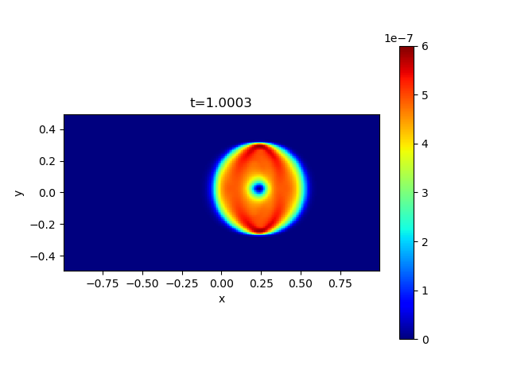
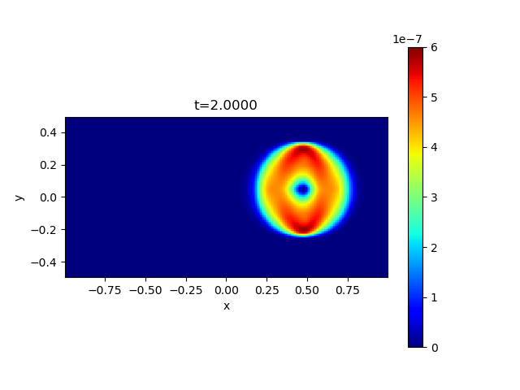
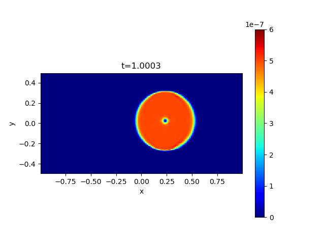
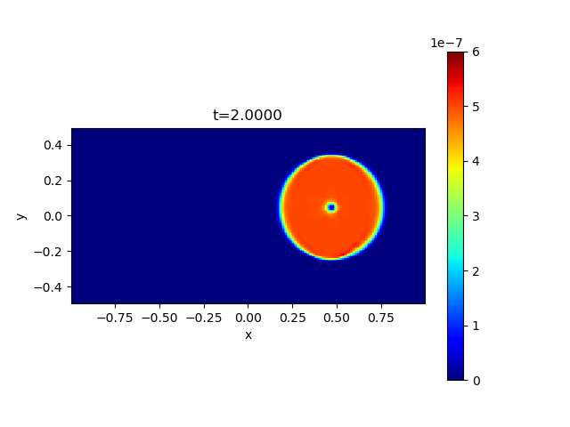

## Field Loop Advection Problem

This problem is first suggested by Gardiner & Stone[^1] to assess the capability to preserve the shape of a weak magnetic field loop during the advection.<br>
The initial condition is *(&rho;,v<sub>x</sub>,v<sub>y</sub>,v<sub>z</sub>,B<sub>z</sub>,P)*=*(1,&radic;5cos(&theta;),&radic;5sin(&theta;),0,0,P<sub>0</sub>)*, and *(B<sub>x</sub>, B<sub>y</sub>)* are calculated from the vector potential *A<sub>z</sub>=*max*(10<sup>-3</sup>(0.3-r),0)* where *r<sup>2</sup>=x<sup>2</sup>+y<sup>2</sup>* and *-1<x<1, -0.5<y<0.5*.<br>
The problem is stringent especially when the flow is well aligned to the axis *(&theta;~0 or &pi;/2)*[^2] and/or the flow is subsonic *(P<sub>0</sub>>>1)*[^3].

The example results of the magnetic pressure for *&theta;=0.01* and *P<sub>0</sub>=1* are shown below.<br>
The top was obtained with the 2nd-order scheme, and the bottom with the 4th-order scheme.

 
 

These figures are shared with the SERIAL example and were generated there with `XMESH=256`, `YMESH=128`, `RMN=2` (LHLLD), `R_K=3`, `CTW=1`, `CFL=0.4`, `DTREC=0.5`, and `N_OUT=4`, using GCC 16.2.0 (C++17, `-O2`) and `OMP_NUM_THREADS=2`. For MPI runs, set `N_OUT=4` (the current default is `11`) and `ODR=2` or `4`, rebuild, then run and merge each case as described below. Use a fresh output directory for each order so that a previous checkpoint is not loaded. In `batch.py`, select output indices `2` and `4`, then set `pm=0.5*(bx**2+by**2+bz**2)` and call `plt2d.image(x, y, pm, equal=1, vmin=0, vmax=6e-7)`. All four panels use the same color scale. The first output is slightly later than `t=1` because the timestep varies; the titles use the actual times in `t.dat`.

### MPI configuration

This case uses the shared MPI `MHD2D` class and solver in `../common/`. Shared sources are compiled separately for this case with its local `mymacros.hpp`. Edit `mhd2d_init_.cpp` for the vector potential, advection velocity, and ambient state. Its temporary vector-potential arrays are local `std::vector` objects allocated with `resize_work()`, which stops all ranks on allocation failure. `mhd2d_paras.cpp` sets the global domain with `setup_grid()` and defines the boundary conditions; `mymacros.hpp` controls the global mesh, MPI decomposition (`MNP_X`, `MNP_Y`), output, and solver choices.

### How to run and visualize

After building the repository-level libraries as described in the [root README](../../../README.md#installation), run these commands from this problem directory:

```sh
make
mkdir -p dat
mpiexec -np 4 env OMP_NUM_THREADS=2 ./a.out
make -C ../common
./merge.out dat
python -i batch.py
```

The default `MNP_X=MNP_Y=2` requires four MPI processes; adjust `-np` to `MNP_X*MNP_Y` if you change the decomposition. `OMP_NUM_THREADS` sets the number of threads per process. Objects are stored in `build/` and the executable is `a.out`.

Build the shared merge utility once with `make -C ../common`. After the simulation finishes, `./merge.out dat` reads rank-local output and writes merged files in the same directory. Enter `dat` and the desired output index at the `batch.py` prompts. The `-i` option keeps the loaded arrays available for additional plotting commands.

The merged `bx, by, bz` arrays are cell-centered; `bxct, byct` retain the CT face fields. Keep the `merge_bx_face_XXXXX.dat` and `merge_by_face_XXXXX.dat` companions alongside each `merge_outdat_XXXXX.dat` file. See [the MPI guide](../README.md) for output formats and restart behavior; an existing backup in `dat/` is loaded automatically when available.

## License

This project is licensed under the GNU General Public License v3.0 - see the [license](../../../license/COPYING) file for details.

[^1]: [Gardiner T. A., and Stone J. M. 2005, JCP](https://www.sciencedirect.com/science/article/pii/S0021999104004784)
[^2]: [Lee, D. 2013, JCP](https://www.sciencedirect.com/science/article/pii/S0021999113001836?via%3Dihub)
[^3]: [Minoshima T., Miyoshi T., and Matsumoto Y. 2019, ApJS](https://iopscience.iop.org/article/10.3847/1538-4365/ab1a36/meta)
