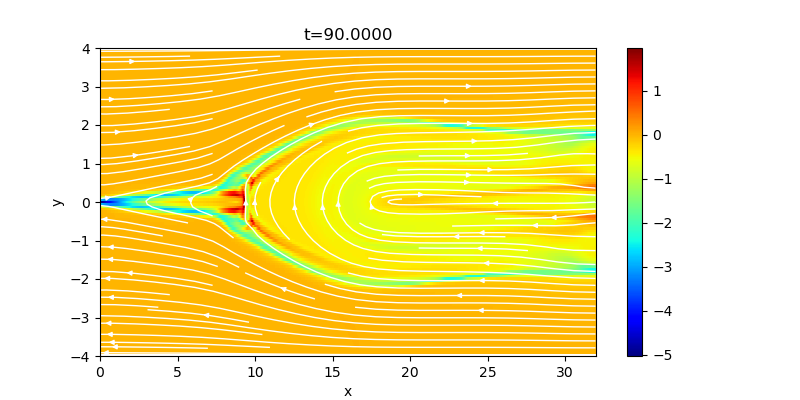

## Magnetic reconnection

In highly conducting plasma with antiparallel magnetic fields, dissipation of electric current causes rapid change of magnetic topology and the convertion of magnetic energy into kinetic and thermal energies, known as magnetic reconnection. 
The initial condition is the Harris equilibrium, *(&rho;,vx,vy,vz,Bx,By,Bz)*=*(&rho;0/cosh2(y/&lambda;)+&rho;1,0,0,0,B0tanh(y/&lambda;),0,0)* where *&rho;0=B0=&lambda;=1,&rho;1=0.2*, and *-4<y<4*. 
The pressure is determined from the pressure balance *(P+B2/2=const)* and the plasma beta at the upstream region *(|y|>>&lambda;)* is 0.2. 
The reconnection is triggered by adding a magnetic perturbation around the center.

In MHD simualtions, the evolution of magnetic reconnection strongly depends on the resistivity model, which is given phenomenologically. 
Uniform resistivity leads to elongated current sheet and slow reconnection (Sweet-Paker model), while localized resistivity causes fast Petscheck-type reconnection. 
Following example is the out-of-plane current with localized resistivity (*&propto;exp(-r/&lambda;), r=&radic;(x2+y2)*, defined in `dmhd2d_init_.cpp`), showing Petscheck-like bifurcated structure.

This figure was regenerated at `t=90` with `XMESH=1024`, `YMESH=128`, `RMN=2` (LHLLD), `ODR=2`, `R_K=3`, `CTW=1`, `CFL=0.4`, `DTREC=5`, `N_OUT=18`, `REV=REM=200`, and `RANDOM=0`, using GCC 16.2.0 (C++17, `-O2`) and `OMP_NUM_THREADS=2`. In `batch.py`, select output index `18`, plot the CT-based current `jz` with `plt2d.image(xjz, yjz, jz, figsize=(8, 4), xmin=0, xmax=32, ymin=-4, ymax=4)`, and overlay magnetic field lines with `plt.streamplot(x, y, bx, by, color="white", density=1.5)`. The title uses the actual time in `t.dat`.

### Serial configuration

This case uses the shared `DMHD2D` implementation in `../common/`; its Makefile selects the dissipative sources with `DISSIPATION := 1`. `dmhd2d_init_.cpp` defines both the initial state and `DMHD2D::setdc()`, where the viscosity and resistivity profiles are configured. `REV` and `REM` in `mymacros.hpp` set their normalization. The current update applies ideal MHD followed by subcycled dissipation.

Edit `mhd2d_paras.cpp` for `setup_grid()` and boundary conditions. The magnetic perturbation remains active with `RANDOM=0`; `RANDOM=1` additionally enables velocity noise through `rand_noise_mt()`. For reproducibility, replace the time-based `seed` in `dmhd2d_init_.cpp` with a fixed value.

See the [serial build and visualization instructions](../README.md). Build with `make` in this directory; objects are kept in `build/`, the executable is `a.out`, and results are written to `dat/`.

## License

This project is licensed under the GNU General Public License v3.0 - see the [license](../../../license/COPYING) file for details.
