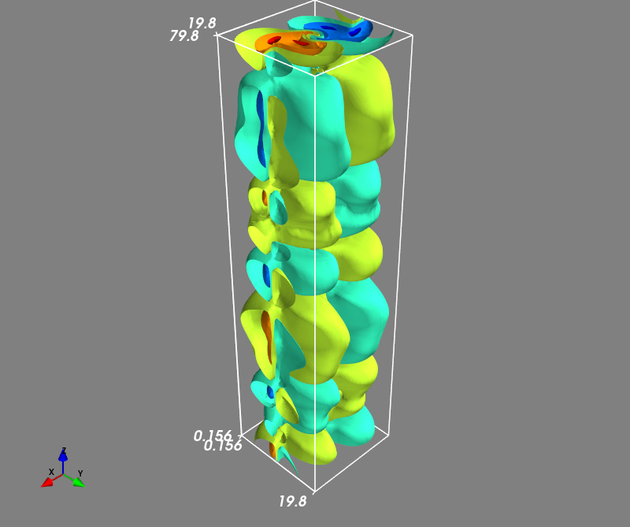

## Kelvin-Helmholtz instability

This is the three-dimensional Kelvin-Helmholtz instability, driven by a velocity shear in the *x* direction across a layer centered at `y=10`. 
The supplied computational domain is `0 < x < 20`, `0 < y < 20`, `0 < z < 80`, with periodic boundaries in *x* and *z* and reflecting boundaries in *y*. 
The unperturbed state has uniform density `1`, gas pressure `5`, and magnetic field `(Bx, By, Bz)=(0,0,1)`. The shear profile is `vx=0.5*tanh(y-10)`, with velocity perturbations added as described below.

### Configuring this case

This case uses the shared `MHD3D` class and ideal solver from `../common/`.

- `mhd3d_init_.cpp` defines the shear layer, density, magnetic-field orientation, and perturbation amplitudes.
- `mhd3d_paras.cpp` defines the global domain and boundary flags through `setup_grid()`.
- `mymacros.hpp` selects the grid, MPI decomposition, numerical methods, and `RANDOM` flag.

With `RANDOM=1`, the `vy` perturbation uses an X/Z-dependent Mersenne-Twister sequence shared across Y ranks; with `RANDOM=0`, it uses a sinusoid in X. The shear amplitude in `vx` remains randomly perturbed in both modes, using a separate Z-only sequence shared across X/Y ranks. Spatial shear and localization profiles are applied to these amplitudes.

For a reproducible initial state, replace `std::time(nullptr)` in `mhd3d_init_.cpp` with a fixed unsigned seed and retain the same mesh and MPI decomposition. See [the MPI guide](../README.md) for building, running, restarting, and merging/reading results.

### Example result

Iso-surfaces of the *y* component of the magnetic field, `by`, at `t=60` are shown below.

