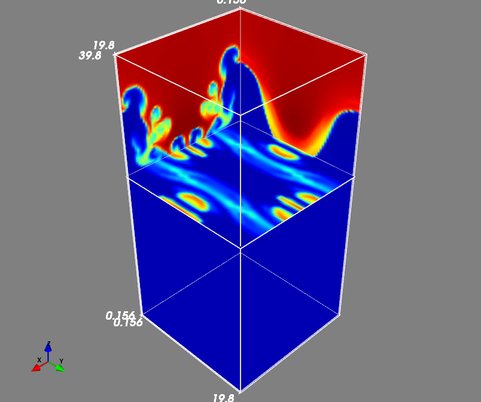

## Rayleigh-Taylor instability

This is the three-dimensional Rayleigh-Taylor instability, in which dense outer layers are accelerated toward a lighter central layer by gravity directed toward `z=0`. 
The supplied computational domain is `0 < x < 20`, `0 < y < 20`, `-40 < z < 40`, with periodic boundaries in *x* and *y* and open boundaries with hydrostatic energy corrections in *z*. 
The initial density varies smoothly from `0.2` in the central layer to `1` in the outer layers, with interfaces near `z=-28` and `z=28`. The pressure is obtained from hydrostatic equilibrium with `P=50` at `z=0`, and the uniform magnetic field is `(Bx, By, Bz)=(0,1,0)`. Small vertical velocity perturbations trigger the instability.

### Configuring this case

This case uses `GMHD3D` from `../common/`, enabled by `GRAVITY = 1` in its Makefile. The conserved total energy includes `rho*phi_g` for a prescribed, time-independent gravitational potential.

- `gmhd3d_init_.cpp` defines the initial state, gravitational potential, and hydrostatic energy corrections at the upper/lower boundaries, assuming density, velocity, and magnetic field are extended unchanged from the interior.
- `mhd3d_paras.cpp` defines the domain and boundary flags using the shared `setup_grid()`.
- `mymacros.hpp` selects the grid, MPI decomposition, numerical methods, and `RANDOM` flag.

With `RANDOM=1`, the `vz` perturbation uses an X/Y-dependent Mersenne-Twister sequence shared across Z ranks, multiplied by the interface-localization profile in Z. With `RANDOM=0`, it uses a cosine product in X and Y, with no random component. For a reproducible random initial state, replace `std::time(nullptr)` in `gmhd3d_init_.cpp` with a fixed unsigned seed and retain the same mesh and MPI decomposition.

Build and run as described in [the MPI guide](../README.md). Pressure conversion subtracts potential energy without modifying the conserved state. Gravity sources use the density at the start of each RK stage.

The potential is written once as `dat/g_potential_<rank>.dat` (float32, including ghost cells). Rebuild the merge utility with `make -C ../common`, then run `./merge.out dat`. It merges the potential into `merge_g_potential.dat` without ghost cells, alongside cell-center fields and the three CT face-field files. The updated `batch.py` subtracts `rho*phi_g` as well as kinetic and magnetic energies when deriving pressure; the stored total energy is not modified. Retain all rank-local potential files when copying raw results, and rerun the merger on old results before using the new Python scripts.

### Example result

Density slices at `t=30` are shown below, illustrating the deformation of the upper interface as the instability develops.

