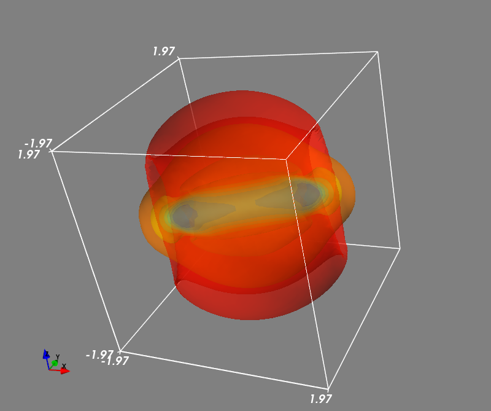

## Blast Wave Problem

This is the three-dimensional blast wave problem, in which an initially stationary, high-pressure sphere expands into a uniformly magnetized medium. 
The supplied periodic computational domain is `-2 < x,y,z < 2`. The initial density is `1` everywhere, and the gas pressure is `100` inside the sphere of radius `0.25` centered at the origin and `1` outside. 
The uniform magnetic field has magnitude `10` and lies in the *x-y* plane at an angle of *30&deg;* to the *x* axis.

### Configuring this case

This case uses the shared `MHD3D` class and ideal solver from `../common/`.

- `mhd3d_init_.cpp` defines the initially stationary, high-pressure sphere: `r_0` sets its radius, `ro0/ro1` and `pr0/pr1` set the ambient/interior states, and `b_0`, `bthe`, and `bphi` set the uniform magnetic field.
- `mhd3d_paras.cpp` defines the global domain and boundary flags through `setup_grid()`; the supplied configuration is periodic in all three directions.
- `mymacros.hpp` selects the grid, MPI decomposition, numerical methods, and CFL number.

See [the MPI guide](../README.md) for building, running, restarting, and merging/reading results. When changing the pressure contrast, magnetic-field strength, or solver settings, check the resulting density and pressure for nonphysical values.

### Example result

Iso-surfaces of the magnetic energy density (equal to the magnetic pressure, `0.5*(bx**2+by**2+bz**2)`, in the code's units) at `t=0.101198` are shown below.

