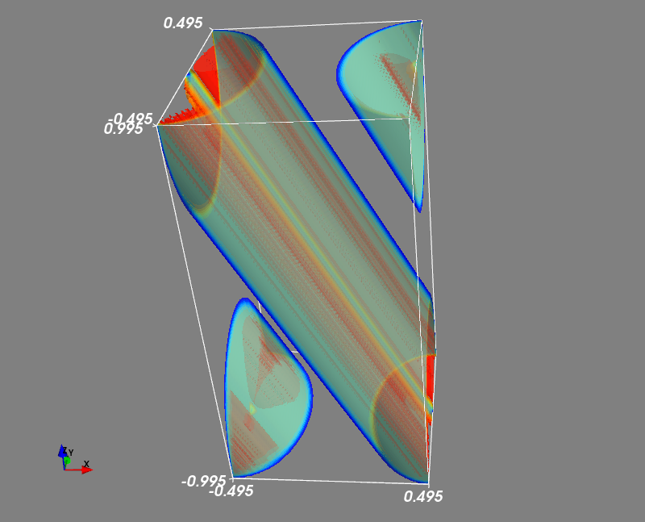

## Field Loop Advection Problem

This is the three-dimensional extension of the field loop advection problem conducted by Gardiner & Stone[^1], and further by Lee[^2] for the small-angle advection. 
The periodic computational domain is `-0.5 < x < 0.5`, `-0.5 < y < 0.5`, `-1 < z < 1`. 
A weak magnetic loop is tilted around the *y* axis by an angle of *tan-1(1/2)* and flows almost in the *x-z* plane. 
(For details of the initial condition, see the literature[^3])

### Configuring this case

This case uses the shared `MHD3D` class and ideal solver from `../common/`.

- `mhd3d_init_.cpp` defines the loop radius `rad`, vector-potential amplitude `a0`, tilt, and advection velocity. CT magnetic fields are initialized from differences of the vector potential using the selected spatial order.
- `mhd3d_paras.cpp` defines the periodic global domain through `setup_grid()`. Keep the periodic wrapping in `cal_r()` consistent if changing the domain or loop geometry.
- `mymacros.hpp` selects the grid, MPI decomposition, and numerical methods.

See [the MPI guide](../README.md) for building, running, restarting, and merging/reading results. Use the separate CT face fields for divergence diagnostics and the cell-center fields for ordinary plots.

### Example result

An example result of the magnetic pressure at one period is shown below. 

[^1]: [Gardiner T. A., and Stone J. M. 2008, JCP](https://www.sciencedirect.com/science/article/pii/S0021999107005669?via%3Dihub) 
[^2]: [Lee, D. 2013, JCP](https://www.sciencedirect.com/science/article/pii/S0021999113001836?via%3Dihub)
[^3]: [Minoshima T., Miyoshi T., and Matsumoto Y. 2019, ApJS](https://iopscience.iop.org/article/10.3847/1538-4365/ab1a36/meta)
